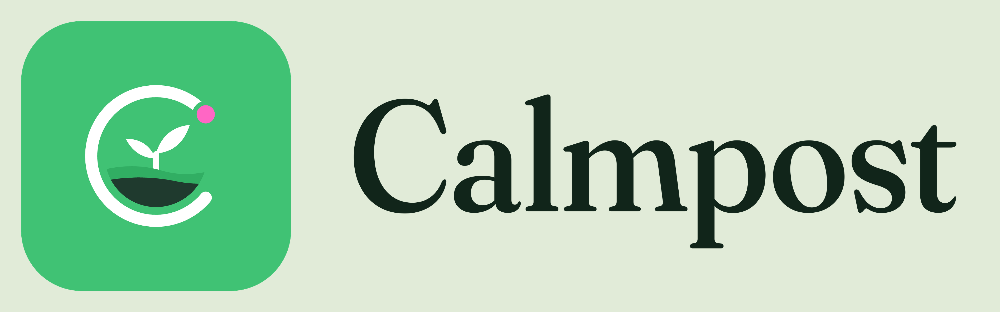

<p align="center">
  <picture>
    <source media="(prefers-color-scheme: dark)" srcset="brand/png/calmpost-lockup-reverse.png">
    
  </picture>
</p>

<p align="center"><b>A smart compost bin and a game that keeps you looking after it.</b><br>
Hack the Valley 11 · Climate Action & Sustainability · Tiger Data track</p>

---

Calmpost is a home compost bin with sensors in it, plus an Android app. The bin measures moisture in two layers, compost temperature and CO₂ about once a second. A webcam watches what you drop in. The app turns all of that into plain advice (add browns, add water, keep that cheese out) and rewards you with XP, streaks and collectibles for looking after it well. You can follow friends and compete in private groups.

**Trunc** is the in-app assistant. It reads your bin's current state and tells you what it needs. Ask "should I add apples?" and the answer depends on what your bin looks like right now.

## How it works

```
Arduino (2 moisture, temp, CO₂) ─USB─▶ bridge ─▶ FastAPI ─▶ Tiger Data
Webcam ─▶ vision (OpenCV + Gemini) ───────────────▲   │
                                                  Gemini
                                                       ▼
                                                 Flutter app
```

- **FastAPI** is the only part that talks to the database and to Gemini, so API keys stay on the laptop and never reach the phone.
- **Tiger Data** stores readings in a hypertable. Charts come from continuous aggregates. Leaderboards are time-window queries over an append-only XP ledger, so nothing is precomputed.
- **Rules decide, Gemini explains.** Every verdict comes from a fixed rules engine. Gemini only identifies items and writes the wording. If Gemini is down, the rules answer on their own.

| Folder | What's in it |
| --- | --- |
| `app/` | Flutter app |
| `backend/` | FastAPI, Tiger Data, Gemini, game and economy |
| `vision/` | Webcam drop detection |
| `firmware/sensor_output/` | Arduino sketch |

Design and game rules live in [AGENTS.md](AGENTS.md).

## Setup

You need **Flutter 3.41.9** (newer versions won't build), **Python 3.12**, **JDK 17**, Android Studio, a Tiger Cloud database and a Gemini API key.

**Backend**
```powershell
cd backend
python -m venv .venv
.venv\Scripts\python.exe -m pip install -r requirements.txt
copy .env.example .env
.venv\Scripts\python.exe -m scripts.init_db --bin bin-001
```
Fill in `DATABASE_URL`, `GEMINI_API_KEY`, `GEMINI_MODEL` and `APP_API_KEY`, and add the `DEVICE_TOKEN` that `init_db` prints.

**Vision**
```powershell
cd vision
python -m venv .venv
.venv\Scripts\python.exe -m pip install -r requirements.txt
.venv\Scripts\python.exe calibrate.py
```
`vision\.env` needs the same Gemini key, app key and device token, plus `BACKEND_URL=http://localhost:8000`, `CAMERA_SOURCE=0` and `GEMINI_VISION_MODEL=gemini-2.5-flash`.

**Hardware:** upload `firmware/sensor_output/sensor_output.ino` to an Arduino UNO R4. Moisture probes go on A0 and A1, DS18B20 temperature probes on D2 and D3 (each needs a 4.7 kΩ pull-up to 5 V), and the STCC4 air module on I²C.

**App**
```powershell
cd app
flutter pub get
flutter config --jdk-dir "<path to JDK 17>"
```
In Android Studio's SDK Manager, install SDK Platforms 35 and 36 and the Command-line Tools.

## Running

```powershell
powershell -ExecutionPolicy Bypass -File start_all.ps1
```
This starts the backend (`:8000`), the sensor bridge and the camera (`:8081`) in separate windows. To have the bridge start at login, run `backend\scripts\install_bridge_autostart.ps1` once.

**On the emulator**
```powershell
cd app
$key = ((Get-Content ..\backend\.env | Select-String '^APP_API_KEY=') -split '=',2)[1].Trim()
flutter run -d emulator-5554 --dart-define=API_URL=http://10.0.2.2:8000 --dart-define=API_KEY=$key
```

**On a phone:** put the laptop and phone on the same hotspot, then build with your laptop's IP and serve the APK:
```powershell
flutter build apk --release --dart-define=API_URL=http://<laptop IP>:8000 --dart-define=API_KEY=$key
cd build\app\outputs\flutter-apk; python -m http.server 8080
```
Open `http://<laptop IP>:8080/app-release.apk` on the phone. Campus Wi-Fi like eduroam won't work, because the app only allows plain HTTP on private network addresses.

The camera feed at `:8081` only runs while a drop is armed. Tap **Drop something in** on Home to start it.

## Calibrating the probes

Each probe needs its own numbers. Ours read 474 and 495 side by side in the same air. Note each probe's raw value in air and in water (shown as `raw=` and `raw2=` in the backend log), then save them from **Profile → Calibrate probes** in the app.

## Tests

```powershell
cd app;     flutter test
cd backend; .venv\Scripts\python.exe -m pytest
cd vision;  .venv\Scripts\python.exe -m pytest
```

## Common problems

| Problem | Fix |
| --- | --- |
| `Errno 10048` | Something already uses the port. Close the other window. |
| `COM3: Access is denied` | Close the Arduino Serial Monitor or the other bridge. |
| App says "Can't reach the bin" | Rebuild with both `API_URL` and `API_KEY`, and check the backend log for 401 or 403. |
| `No module named 'cv2'` | Use `.venv\Scripts\python.exe`, not plain `python`. |
| Android build fails with `25.0.3` | Flutter is on JDK 25. Point it at JDK 17. |

## Limits

The bottom temperature sensor broke, so the bottom layer reports moisture only. Readings are a guide rather than a lab measurement. Everything runs on a laptop over a hotspot, and the APK uses debug signing. It's a hackathon prototype.
